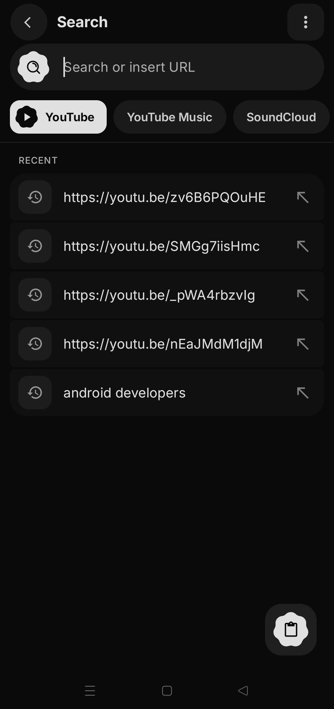
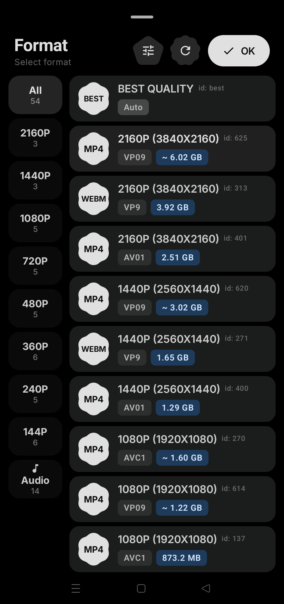
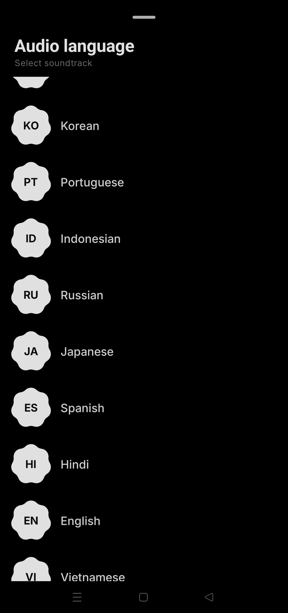
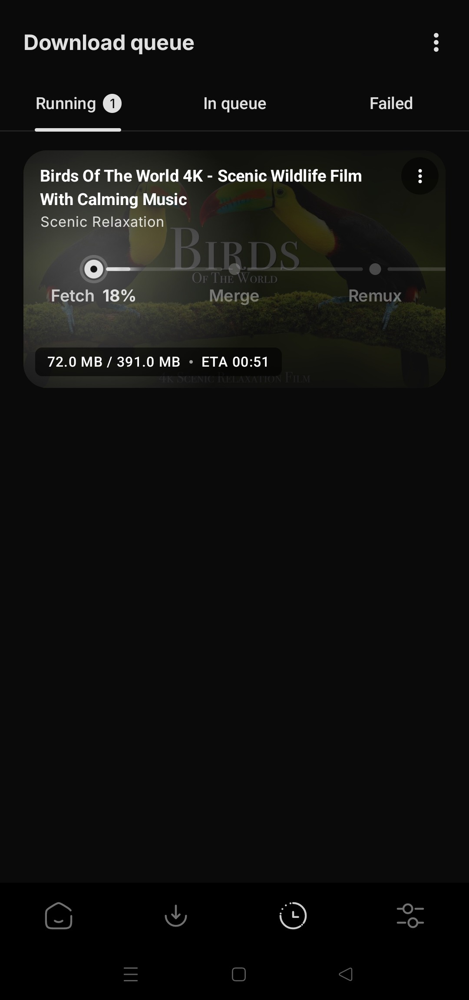
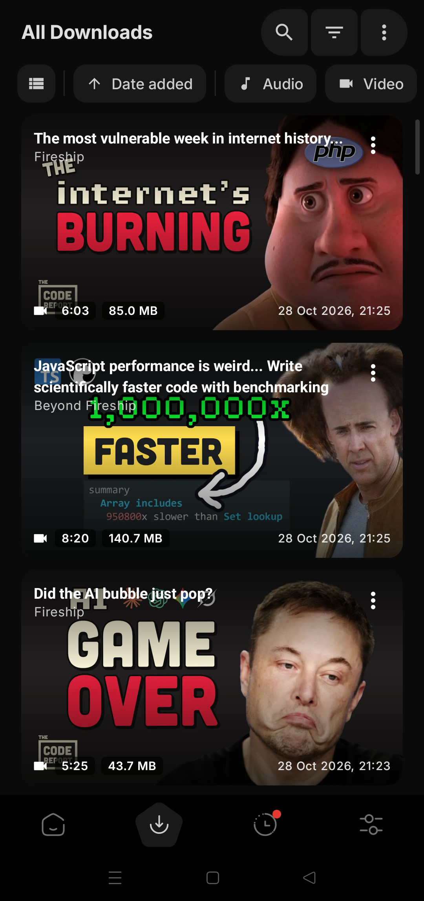
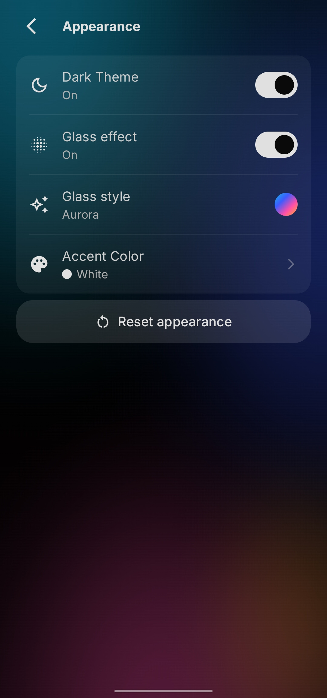
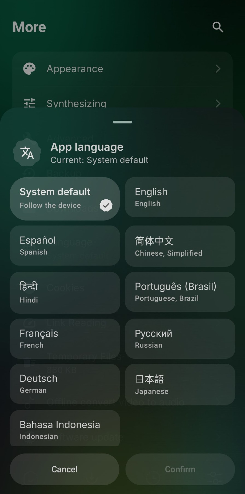
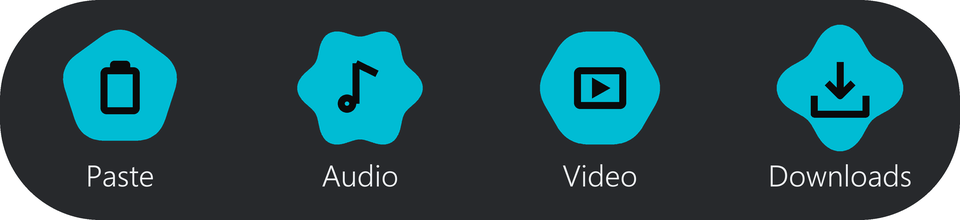
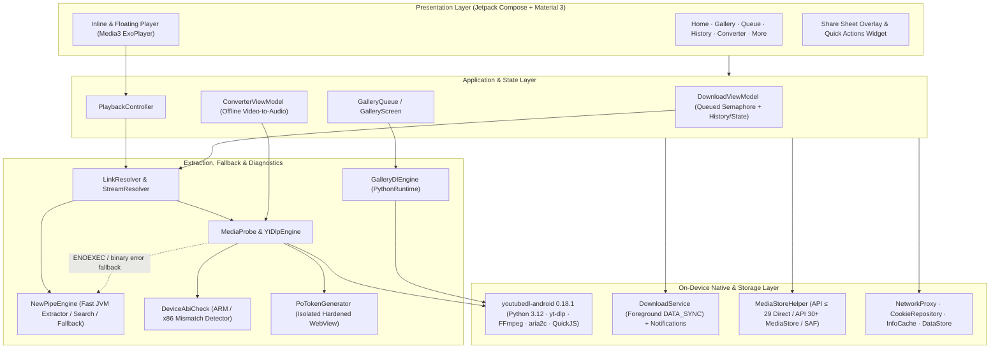

<div align="center">


# Media Converter

**A fast, private, open-source Android media downloader, gallery saver, stream player, and offline audio converter.**

[](https://github.com/muhammedasadn/mediaconverter/releases/latest)
[](https://github.com/muhammedasadn/mediaconverter/actions/workflows/ci.yml)
[-3DDC84?style=for-the-badge&logo=android&logoColor=white)](#android-compatibility--apk-guide)
[](#architecture)
[](https://github.com/muhammedasadn/mediaconverter/releases)
[](LICENSE)

[Download APK](https://github.com/muhammedasadn/mediaconverter/releases/latest) · [Architecture](#architecture) · [Screenshots](#screenshots) · [APK Guide](#android-compatibility--apk-guide) · [Full Documentation](DOCUMENTATION.md)

</div>

---

## Features

- **1,500+ Video & Audio Sites (`yt-dlp` + `NewPipeExtractor`):** Download videos, audio tracks, playlists, and channels with resilient JVM fast-path extraction and `yt-dlp` fallback.
- **Image & Carousel Gallery Saver (`gallery-dl`):** Inspect and save photos, profiles, and multi-item posts across image platforms.
- **In-App Stream Preview & Search:** Instant search across YouTube, YouTube Music, and SoundCloud, plus built-in playback powered by **AndroidX Media3 ExoPlayer**.
- **Precision Quality & Format Control:** Pick exact resolutions up to 4K (`VP9`, `AV1`, `AVC`), containers (`MP4`, `MKV`, `MP3`, `M4A`, `OPUS`, `FLAC`), multi-language audio tracks, subtitles, SponsorBlock skipping, chapters, and video trim/cut ranges.
- **100% Offline Video-to-Audio Converter:** Convert local device videos into `MP3`, `M4A`, `OPUS`, `FLAC`, and other audio formats using bundled **FFmpeg** with zero internet needed.
- **Privacy & Security Hardened:** Zero ads, zero analytics, **Incognito Mode**, TLS certificate enforcement by default, hardened WebViews, **Auto PO Token** generation, cookie sign-in isolation, and process-wide **HTTP/SOCKS5 proxy** support.
- **Adaptive Material 3 Glass UI:** Material 3 expressive shapes, animated glass styles, custom accent colors, dark/light themes, home screen Quick Actions widget, and **10 languages**.

---

## Screenshots

<table>
  <tr>
    <td align="center"><br/><sub><b>Search & Paste URL</b></sub></td>
    <td align="center"><br/><sub><b>Format & Codec Ladder</b></sub></td>
    <td align="center"><br/><sub><b>Audio Track Selection</b></sub></td>
    <td align="center"><br/><sub><b>Live Queue & Remux</b></sub></td>
  </tr>
  <tr>
    <td align="center"><br/><sub><b>Downloads Library</b></sub></td>
    <td align="center"><br/><sub><b>Glass Appearance</b></sub></td>
    <td align="center"><br/><sub><b>10 Built-in Languages</b></sub></td>
    <td align="center"><br/><sub><b>Home Screen Widget</b></sub></td>
  </tr>
</table>

---

## Architecture

Media Converter uses a clean layered Android architecture with deferred native runtime unpacking (`HazelApp.startLibraryInit`) and automatic fallback between pure-JVM extraction and on-device native engines:



---

## Android Compatibility & APK Guide

Verified permission, foreground-service, and storage support across **Android 7.0 – 15+ (API 24 – 35)** and **PC Android Emulators**:

| APK File | Best For | Why Choose This Build |
|---|---|---|
| `MediaConverter-vX.Y.Z-arm64-v8a-debug.apk` | **Physical Android phones** (2017+) | Smallest modern phone APK (~85 MB) |
| `MediaConverter-vX.Y.Z-x86_64-debug.apk` | **PC Emulators & WSA** (BlueStacks, LDPlayer, Nox, AVD) | Native `x86_64` `libpython.so` — avoids ARM translation `ENOEXEC` errors |
| `MediaConverter-vX.Y.Z-armeabi-v7a-debug.apk` | **Older 32-bit Android phones** | Legacy ARMv7 hardware support |
| `MediaConverter-vX.Y.Z-x86-debug.apk` | **Legacy 32-bit emulators** | Native 32-bit `x86` support |
| `MediaConverter-vX.Y.Z-universal-debug.apk` | **Any device / unsure** | Bundles all 4 CPU architectures (~224 MB) |

### Key Platform Safeguards
- **Android 7 – 10 (`API 24–29`):** Scoped `WRITE_EXTERNAL_STORAGE` (`maxSdkVersion="29"`), `requestLegacyExternalStorage="true"`, and `MediaScannerConnection` direct moves into `Download/MediaConverter` & `Music/MediaConverter`.
- **Android 11 – 15+ (`API 30–35`):** Zero-permission `MediaStore` `IS_PENDING` publishing + Storage Access Framework (SAF / SD card) tree writes.
- **Android 12 – 15+ Background Execution:** `DownloadService` (`foregroundServiceType="dataSync"`), immediate foreground promotion on `ACTION_STOP` (prevents `ForegroundServiceDidNotStartInTimeException`), `FLAG_IMMUTABLE` `PendingIntent`s, and `POST_NOTIFICATIONS` runtime handling on Android 13+.
- **Native Runtime Packaging:** `extractNativeLibs="true"`, `useLegacyPackaging = true`, unstripped `.so` binaries (`keepDebugSymbols += "**/*.so"`), and synchronized `libraryReady` startup locking.

---

## Network vs. Offline Behavior

| Area | Internet Needed? | Details |
|---|---|---|
| **Link Reading, Search, Downloading & Stream Preview** | Yes | Connects directly from your device to source platforms (or via your HTTP/SOCKS5 proxy). No developer backend server is used. |
| **Offline Video-to-Audio Converter** | **No (100% Offline)** | Converts local video files into audio via bundled FFmpeg. |
| **Post-Download Trim, History & Backup** | **No (100% Offline)** | Runs locally on-device with no external network requests. |

---

## Build & Development Checks

### Local Build
- **Requirements:** JDK 17 + Android SDK (compileSdk `37`, minSdk `24`, targetSdk `35`)
```powershell
.\gradlew.bat :app:assembleGithubDebug
```

### Cloud Build (GitHub Actions)
Push to `main` to trigger `.github/workflows/ci.yml` (`Unit tests`, `Build APK`, `String resources`), or push a `v*` tag to trigger `.github/workflows/release.yml` and publish all 5 ABIs.

### Validation Scripts
```powershell
python tools/strings/check.py resources
python tools/strings/check.py translations
```

---

## License & Attribution

Licensed under the [**GNU General Public License v3.0 or later**](LICENSE) (`GPL-3.0-or-later`).

**Media Converter** (`com.muhammedasadn.mediaconverter`) is maintained by [@muhammedasadn](https://github.com/muhammedasadn) and is built upon the open-source [Hazel](https://github.com/SibtainOcn/Hazel) project by [SibtainOcn](https://github.com/SibtainOcn).

Powered by open-source components:
- [yt-dlp](https://github.com/yt-dlp/yt-dlp) · [youtubedl-android](https://github.com/yausername/youtubedl-android) · [gallery-dl](https://github.com/mikf/gallery-dl) · [NewPipeExtractor](https://github.com/TeamNewPipe/NewPipeExtractor) · [AndroidX Media3](https://github.com/androidx/media)
